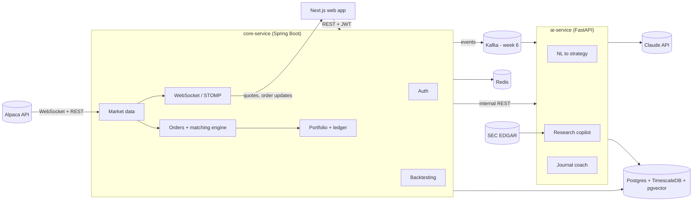
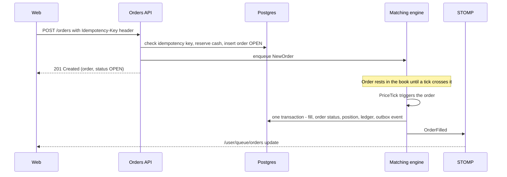
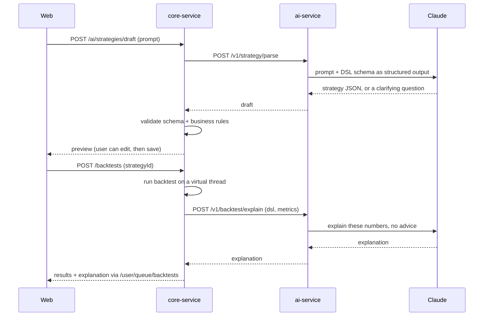

# Trading Lab — AI Paper-Trading & Strategy Platform

A personal project to support a job switch: a paper-trading platform with live US market data, a Java matching engine, a backtesting engine, and GenAI features (plain-English strategies, a research copilot with citations, and a trade-journal coach).

> **Scope guardrails:** paper money only, never real funds. The AI explains and analyzes; it never gives buy/sell recommendations. The UI shows "Educational use only — not investment advice."

---

## 1. Decisions so far

| Topic | Decision | Why |
|---|---|---|
| Project | AI paper-trading and strategy lab (replaces the earlier AI mock-interviewer idea) | Strong system-design story, fintech fit, real GenAI use |
| Core backend | **Java + Spring Boot** | Most in-demand backend stack; trading systems are commonly Java; new skill to learn |
| AI backend | **Python + FastAPI** | Best AI tooling; existing skill; Java core + Python AI mirrors real fintech setups |
| Frontend | Next.js + TypeScript | Existing skill |
| Market | **US stocks via Alpaca** | Free paper-trading account with just an email; REST + WebSocket data. India can be added later behind an interface |
| Architecture | **Modular monolith first** (Spring Modulith); Kafka added in week 6 | Avoids microservice overhead for one developer; Kafka arrives when there is a real reason (separate ingestor) |
| Strategy execution | **JSON strategy DSL interpreted by Java**; never run LLM-generated code | Security and determinism |
| LLM role | LLM writes and explains; **all numbers come from code** | LLMs are unreliable at arithmetic; keeps results trustworthy |
| Experience level | Java is new → a ramp-up week (week 0) is built in | Learn by building real modules, not tutorials |

---

## 2. Scope

### In scope (MVP)
- Sign-up/login, watchlists, instrument search
- Live and historical prices, charts, **replay mode** (replays history as a fake live feed so demos work outside US market hours)
- Paper account ($100,000 starting cash), market/limit/stop/stop-limit orders, DAY/GTC, long-only
- Own matching engine filling against live quotes, positions, realized/unrealized P&L
- Backtesting with standard metrics and a buy-and-hold benchmark
- AI: plain English → strategy → backtest → explanation
- AI: research copilot over SEC filings and news, with citations
- AI: trade-journal coach
- Evals, observability, CI, deployed demo

### Out of scope
- Real-money trading, brokerage features, margin, short selling, options
- Personalized investment advice
- Mobile apps (responsive web only)

---

## 3. Tech stack

| Layer | Choice | Notes |
|---|---|---|
| Frontend | Next.js (App Router), TypeScript, Tailwind, shadcn/ui | TanStack Query for server state, Zustand for UI state |
| Charts | TradingView Lightweight Charts | Candles, volume, equity curve |
| Realtime client | `@stomp/stompjs` over WebSocket | Subscribes to quote and order topics |
| Core service | Java 21 (LTS), Spring Boot, Maven | Virtual threads on (`spring.threads.virtual.enabled=true`) |
| Core libraries | Spring Web, Security, Data JPA, Validation, WebSocket, Actuator, Flyway, Spring Modulith, springdoc-openapi, Resilience4j, Bucket4j | Records for DTOs instead of Lombok |
| AI service | Python 3.12, FastAPI, Pydantic v2, `uv`, `anthropic` SDK, psycopg 3, pgvector | Internal only; not exposed publicly |
| LLMs | `claude-haiku-5-5` (fast: parsing, narration), `claude-sonnet-5-5` (copilot answers, explanations, eval judge) | Upgrade a route to `claude-opus-5-5` only if evals show it's needed |
| Embeddings | Voyage AI, or a local open-source model (e.g. bge-small via sentence-transformers) | Pick one; keep the dimension in config |
| Database | PostgreSQL + TimescaleDB + pgvector | `timescale/timescaledb-ha` image bundles pgvector (verify version) |
| Cache / limits | Redis | Latest quotes, rate-limit buckets, LLM budgets |
| Events | Spring Modulith events (weeks 0–5) → Kafka (week 6) | Redpanda locally (Kafka-compatible, lighter) |
| Observability | Micrometer, Prometheus, Grafana, OpenTelemetry, Jaeger | Traces across Java → Kafka → Python |
| Testing | JUnit 5, Mockito, AssertJ, jqwik, Testcontainers, pytest, Playwright, Gatling | See §12 |
| CI/CD | GitHub Actions, GHCR images | Path-filtered jobs per service |
| Hosting | One VM with Docker Compose + Caddy (TLS); frontend on Vercel | Cheapest; Fly.io/Railway also fine |

---

## 4. Architecture



### Boundaries
- **core-service owns all trading data** (accounts, orders, fills, positions, strategies, backtests) and orchestrates every flow.
- **ai-service is mostly stateless.** It owns only documents, chunks, LLM call logs and eval results. It never writes trading tables.
- The browser talks **only to core-service**. Core proxies AI requests after authentication and rate limiting.
- **contracts/** holds JSON Schemas shared by both services (strategy DSL, event payloads). Both sides validate against the same files.

### Core modules (Spring Modulith packages)
| Module | Responsibility |
|---|---|
| `auth` | Register, login, JWT access + refresh tokens |
| `marketdata` | `MarketDataProvider` interface; `AlpacaProvider`, `ReplayProvider`; bar backfill; latest quotes |
| `trading` | Orders API, matching engine, fills |
| `portfolio` | Accounts, cash ledger, positions, P&L |
| `strategy` | DSL parsing/validation, indicators, rule evaluator (shared by backtests and future live strategies) |
| `backtest` | Backtest runs, metrics, results |
| `realtime` | STOMP config, broadcasters |
| `ai` | Client for ai-service |
| `common` | Errors (RFC 9457 `ProblemDetail`), idempotency, `MarketClock`, utilities |

`MarketClock` is an interface for "what time is it and is the market open". Live mode uses the real clock and Alpaca's market calendar; replay mode and tests use a controllable clock. This makes tests deterministic.

---

## 5. Repository structure

```
trading-lab/
├── PLAN.md
├── README.md
├── docker-compose.yml
├── .env.example
├── .github/workflows/          # core.yml, ai.yml, web.yml, deploy.yml
├── contracts/
│   ├── strategy-dsl.v1.schema.json
│   └── events/                 # order-filled.v1.schema.json, ...
├── core-service/               # Spring Boot (Java 21, Maven)
│   ├── pom.xml
│   └── src/
│       ├── main/java/com/tradinglab/
│       │   ├── auth/  marketdata/  trading/  portfolio/
│       │   ├── strategy/  backtest/  realtime/  ai/  common/
│       └── main/resources/
│           ├── application.yml
│           └── db/migration/   # Flyway V1__init.sql, ...
├── market-data-ingestor/       # added in week 6 (Spring Boot, publishes to Kafka)
├── ai-service/                 # FastAPI
│   ├── pyproject.toml
│   ├── app/
│   │   ├── api/  llm/  strategy/  copilot/  journal/  ingest/
│   └── evals/
│       ├── strategy_gen.jsonl
│       ├── copilot.jsonl
│       └── run_evals.py
├── web/                        # Next.js
│   └── src/app/                # (auth) dashboard trade backtests strategies copilot journal
└── infra/                      # prometheus.yml, grafana dashboards, otel config, Caddyfile
```

---

## 6. Data model

All money and prices use `NUMERIC` in Postgres and `BigDecimal` in Java. Never floats.

### core-service tables
| Table | Key columns | Notes |
|---|---|---|
| `users` | id, email (unique), password_hash, created_at | BCrypt hashes |
| `accounts` | id, user_id, cash, reserved_cash, starting_cash, version | One paper account per user (MVP) |
| `cash_ledger` | id, account_id, type (DEPOSIT/RESERVE/RELEASE/BUY/SELL/FEE), amount, ref_type, ref_id, created_at | Append-only audit of every cash change |
| `instruments` | symbol (PK), name, exchange, tradable | Seeded from Alpaca's assets endpoint |
| `watchlists`, `watchlist_items` | id, user_id, name / watchlist_id, symbol | |
| `price_bars` | symbol, timeframe, ts, open, high, low, close, volume | **Timescale hypertable** on `ts`; continuous aggregates build 5m/1h/1d from 1m |
| `orders` | id (UUID), account_id, client_order_id, symbol, side, type, qty, limit_price, stop_price, time_in_force, status, filled_qty, avg_fill_price, reject_reason, created_at, updated_at, version | `UNIQUE(account_id, client_order_id)` = idempotency |
| `fills` | id, order_id, qty, price, fee, ts | |
| `positions` | account_id + symbol (PK), qty, avg_cost, realized_pnl, version | Weighted-average cost |
| `strategies` | id, user_id, name, dsl (JSONB), dsl_version, source_prompt, created_at | `source_prompt` set when AI drafted it |
| `backtest_runs` | id, strategy_id, params (JSONB), input_hash, status, metrics (JSONB), error, started_at, finished_at | Same `input_hash` → same results |
| `backtest_trades` | run_id, symbol, entry_ts, entry_price, exit_ts, exit_price, qty, pnl | |
| `backtest_equity` | run_id, ts, equity, drawdown | For charts |
| `event_publication` | (managed by Spring Modulith) | Transactional outbox for events |

Order status flow: `NEW → OPEN → FILLED`, or `OPEN → CANCELLED / EXPIRED`, or `NEW → REJECTED`. (`PARTIALLY_FILLED` exists in the enum for later; MVP fills fully.)

### ai-service tables
| Table | Key columns | Notes |
|---|---|---|
| `documents` | id, ticker, source (SEC/NEWS), form_type, filed_at, url, title | |
| `doc_chunks` | id, document_id, section, content, tsv (`tsvector`), embedding (`vector(N)`) | GIN index on `tsv`, HNSW index on `embedding` |
| `llm_calls` | id, feature, model, input_tokens, output_tokens, cache_read_tokens, cost_usd, latency_ms, stop_reason, trace_id, user_id, created_at | Powers cost dashboards |
| `eval_runs` | id, suite, git_sha, prompt_version, model, metrics (JSONB), created_at | Track scores over time |

---

## 7. Key flows

### 7.1 Market data
1. On startup, `AlpacaProvider` connects to Alpaca's market data WebSocket (free IEX feed) and subscribes to symbols on users' watchlists and in open orders.
2. Each quote or trade is normalized into a `Quote` record and published as a `QuoteReceived` event.
3. Listeners: the latest quote is written to Redis; the matching engine gets the tick; the realtime module broadcasts to `/topic/quotes.{symbol}` (throttled, e.g. at most 4 updates per second per symbol).
4. A bar aggregator builds 1-minute bars and writes them to `price_bars`. Timescale continuous aggregates build larger timeframes.
5. A backfill job loads 5 years of daily bars and recent 1-minute bars for each new symbol, with split/dividend-adjusted prices.
6. **Replay mode** (`marketdata.provider=replay`): `ReplayProvider` streams stored bars as quotes at N× speed, driven by the controllable `MarketClock`.

### 7.2 Placing and filling an order



**Validation before accepting an order:** symbol is tradable; qty > 0; limit/stop prices present for those types; market is open for market orders (else reject, or accept as DAY for the next session — pick one and document it); enough buying power.

**Buying power and reservations:**
- Buying power = `cash − reserved_cash`.
- A buy reserves `qty × (limit price, or current ask) × (1 + buffer)` with one atomic conditional update: `UPDATE accounts SET reserved_cash = reserved_cash + :amt WHERE id = :id AND cash - reserved_cash >= :amt`. Zero rows updated → reject. This keeps cash from ever going negative, even under concurrent requests.
- The reservation is released on fill (the actual cost is applied instead) or on cancel/expiry.
- Sells check that position qty minus qty already in open sell orders covers the order.

**Matching engine design (the main concurrency learning piece):**
- One `OrderBook` per symbol, each owned by **one single-threaded event loop** (one thread drains a `BlockingQueue` of events: `NewOrder`, `CancelOrder`, `PriceTick`). Because only one thread touches a book, the book needs no locks. This is the LMAX "single writer" idea.
- Resting buy limits: `TreeMap<BigDecimal, ArrayDeque<Order>>` sorted high → low; sell limits sorted low → high. Stop orders in separate maps keyed by stop price. Within a price level, first-in first-out.
- On each tick (bid, ask, last):
  1. Trigger stops (buy stop if ask ≥ stop; sell stop if bid ≤ stop) → become market or limit orders.
  2. Fill buy limits where limit ≥ ask, at the ask; sell limits where limit ≤ bid, at the bid.
  3. Market orders fill at ask (buy) or bid (sell) plus configurable slippage (e.g. 5 basis points). If the quote is stale or missing, use last trade price ± slippage.
- Fills are written in one `@Transactional` method. Positions use `@Version` optimistic locking with retry, since one account can trade several symbols on different threads.
- **Recovery:** on startup, rebuild every book from `OPEN` orders in the database before subscribing to ticks.
- **Expiry:** a scheduled job expires DAY orders at market close (via `MarketClock`).

**P&L:**
- Buy: `avg_cost = (old_qty × old_avg + fill_qty × fill_price) / new_qty`.
- Sell: `realized_pnl += (fill_price − avg_cost) × qty − fee`.
- Equity = cash + Σ(position qty × last price). Unrealized P&L = Σ(qty × (last − avg_cost)).

### 7.3 Backtesting
1. `POST /backtests` with strategy ID, symbols, date range, timeframe (default 1D), initial cash, fee and slippage settings.
2. Create the run (`QUEUED`), return its ID, run it on a virtual thread, and notify `/user/queue/backtests` when done.
3. Engine loop, bar by bar:
   - Update indicators with bar *t*.
   - Evaluate entry/exit rules at the **close of bar t**.
   - Execute at the **open of bar t+1**. This prevents look-ahead bias (using data the strategy couldn't have had yet).
   - Check stop-loss and take-profit against each bar's high/low.
4. Compute metrics and a buy-and-hold benchmark over the same period, then store trades and the equity curve.

| Metric | Definition |
|---|---|
| Total return | `end_equity / start_equity − 1` |
| CAGR | `(end / start)^(252 / trading_days) − 1` |
| Sharpe ratio | `mean(daily returns) / stdev(daily returns) × √252` (risk-free rate 0) |
| Max drawdown | Largest `(peak − equity) / peak` |
| Win rate | Winning trades / total trades |
| Profit factor | Gross profit / gross loss |
| Exposure | % of bars with an open position |

Known pitfalls to note in the README: survivorship bias (only current tickers are tested), overfitting (stretch: walk-forward testing), use of adjusted prices.

### 7.4 Strategy DSL (v1)

Defined once in `contracts/strategy-dsl.v1.schema.json`. Java validates it (networknt json-schema-validator) and parses it into a sealed-interface AST. Python generates Pydantic models from the same schema (datamodel-code-generator).

```json
{
  "dslVersion": 1,
  "name": "20/50 SMA crossover",
  "symbols": ["AAPL"],
  "timeframe": "1D",
  "entry": {
    "crossesAbove": [
      { "indicator": "SMA", "period": 20 },
      { "indicator": "SMA", "period": 50 }
    ]
  },
  "exit": {
    "crossesBelow": [
      { "indicator": "SMA", "period": 20 },
      { "indicator": "SMA", "period": 50 }
    ]
  },
  "risk": { "stopLossPct": 5, "takeProfitPct": 15 },
  "sizing": { "type": "percentOfEquity", "value": 10 }
}
```

- **Conditions:** `crossesAbove`, `crossesBelow`, `gt`, `lt`, `all`, `any`, `not`
- **Operands:** price (`open`/`high`/`low`/`close`), indicator (`SMA`, `EMA`, `RSI`, `MACD`, `BOLLINGER`, `ATR` with `period`), constant
- **Risk:** `stopLossPct`, `takeProfitPct` (stretch: `trailingStopPct`)
- **Sizing:** `percentOfEquity`, `fixedQty`, `fixedCash`; `maxPositions`

Java side: `sealed interface Condition permits CrossesAbove, CrossesBelow, Gt, Lt, All, Any, Not`, record implementations, evaluated with pattern-matching `switch`. Implement SMA, EMA and RSI yourself; use ta4j only as a reference to check your numbers.

### 7.5 Plain English → strategy → backtest



- Model: `claude-haiku-5-5` with structured outputs (`client.messages.parse()` against the generated Pydantic DSL model), effort `low` for speed.
- If the request is ambiguous ("buy when it's cheap"), the response contains a clarifying question, not a guessed strategy.
- Explanations use `claude-sonnet-5-5` and get only the computed metrics. A post-check confirms every number in the explanation appears in the metrics.

### 7.6 Research copilot (RAG with citations)

**Ingestion** (ai-service job, triggered by core when a symbol is added, plus nightly):
1. Fetch the latest 10-K and 10-Q filings from SEC EDGAR (`data.sec.gov` submissions API). Send a descriptive `User-Agent` with contact email and stay under SEC's 10 requests/second limit.
2. Extract key sections (Item 1 Business, Item 1A Risk Factors, Item 7 MD&A).
3. Fetch recent news from Alpaca's news API.
4. Chunk (~800 tokens, ~100 overlap), embed, and store with metadata (ticker, form, date, section, URL).
5. Optional: summarize new filings in bulk with the Message Batches API (asynchronous, cheaper).

**Answering:**
1. Hybrid retrieval: Postgres full-text search (`tsvector`) + pgvector cosine similarity, merged with Reciprocal Rank Fusion, filtered by ticker and date.
2. Optional reranking of the top ~30 chunks down to ~8.
3. `claude-sonnet-5-5` answers with the chunks passed as `document` blocks with **citations enabled**. Claude returns citation objects pointing at the exact text, which the UI maps to the filing URL and section. (Native citations can't be combined with structured output format, so this route returns text plus citations.)
4. Stream the answer to the browser (ai-service → core → browser via SSE).
5. Retrieved text is untrusted: it goes in document blocks only, and the copilot has no tools that can change anything.

### 7.7 Trade-journal coach
1. Core computes the statistics in SQL/Java: win rate, average holding period, average win vs. loss, P&L by symbol and time of day, and how prices moved after exits (did you sell winners too early?).
2. ai-service receives only that stats JSON and `claude-haiku-5-5` writes 3–5 short observations about behavior, not recommendations.
3. From week 6, an `OrderFilled` Kafka event triggers a background refresh of insights.

---

## 8. API surface

### core-service REST (`/api/v1`)
| Area | Endpoints |
|---|---|
| Auth | `POST /auth/register`, `POST /auth/login`, `POST /auth/refresh`, `POST /auth/logout`, `GET /me` |
| Watchlists | `GET/POST /watchlists`, `DELETE /watchlists/{id}`, `POST/DELETE /watchlists/{id}/items/{symbol}` |
| Market | `GET /instruments?query=`, `GET /market/bars?symbol=&timeframe=&from=&to=`, `GET /market/quotes/{symbol}`, `GET /market/clock` |
| Account | `GET /account` (cash, buying power, equity), `GET /positions`, `GET /fills` |
| Orders | `POST /orders` (requires `Idempotency-Key`), `GET /orders?status=`, `GET /orders/{id}`, `DELETE /orders/{id}` |
| Strategies | `POST /strategies`, `GET /strategies`, `GET/PUT/DELETE /strategies/{id}` |
| Backtests | `POST /backtests`, `GET /backtests/{id}`, `GET /backtests/{id}/trades`, `GET /backtests/{id}/equity` |
| AI (proxied) | `POST /ai/strategies/draft`, `POST /ai/copilot/ask` (SSE), `GET /ai/journal/insights` |

Errors use RFC 9457 `ProblemDetail` JSON. OpenAPI docs are served at `/swagger-ui`.

### WebSocket (STOMP at `/ws`)
| Destination | Content |
|---|---|
| `/topic/quotes.{symbol}` | Latest bid/ask/last |
| `/topic/bars.{symbol}.1m` | Each closed 1-minute bar |
| `/user/queue/orders` | Order status changes for the logged-in user |
| `/user/queue/backtests` | Backtest completed or failed |

### ai-service (internal only)
`POST /v1/strategy/parse`, `POST /v1/backtest/explain`, `POST /v1/copilot/ask` (SSE), `POST /v1/journal/insights`, `POST /v1/ingest/filings`. Authenticated with a shared service token; not reachable from the internet.

### Kafka topics (week 6)
| Topic | Key | Producer → consumer |
|---|---|---|
| `market.quotes` | symbol | market-data-ingestor → core |
| `market.bars.1m` | symbol | market-data-ingestor → core |
| `trading.order-events` | account ID | core (outbox) → notifications/audit consumers |
| `trading.fills` | account ID | core (outbox) → ai-service journal coach |

Keying by symbol/account keeps events for one entity in order. Consumers must be idempotent (keep a processed-event-ID table).

---

## 9. AI service details

| Feature | Model | Technique | Effort |
|---|---|---|---|
| NL → strategy | `claude-haiku-5-5` | Structured outputs against the DSL schema | `low` |
| Backtest explanation | `claude-sonnet-5-5` | Plain text from computed metrics | `medium` |
| Research copilot | `claude-sonnet-5-5` | Hybrid RAG + native citations, streaming | `medium` |
| Journal coach | `claude-haiku-5-5` | Narrates precomputed stats | `low` |
| Eval judge | `claude-sonnet-5-5` | Rubric grading; check against your own labels | `medium` |

**One LLM wrapper (`app/llm/`)** that every feature uses:
- Logs model, tokens (including cache reads), latency, cost, `stop_reason` and trace ID to `llm_calls`.
- Checks a per-user daily token budget in Redis before calling.
- Handles stop reasons: `refusal` (show a friendly message), `max_tokens` (log and retry with a higher limit, or fail cleanly).
- Uses the SDK's typed exceptions and built-in retries; doesn't string-match error messages.
- Prompt caching: keep the system prompt and DSL schema stable and first, mark them with `cache_control`, and confirm `cache_read_input_tokens > 0` on repeat calls. Very short prompts won't cache.
- Prompts live in versioned files (`prompts/strategy_parse.v3.md`). The version is logged with every call and every eval run.

**Guardrails:**
- System prompts: educational analysis only; no personalized buy/sell/hold advice. Questions like "Should I buy NVDA?" get a neutral, factual reframe.
- A refusal-for-advice test set is part of the evals.
- Numbers come only from code; explanations are checked against the metrics.

---

## 10. Evals

| Suite | Size | Metrics | Target (adjust after baseline) |
|---|---|---|---|
| `strategy_gen` | 50 prompts → expected DSL | Schema-valid rate, field-level accuracy, asks for clarification when ambiguous | ≥ 95% valid, ≥ 85% field accuracy |
| `copilot` | 30–50 questions with gold source chunks | Retrieval recall@8, citation precision, faithfulness (LLM judge) | Recall@8 ≥ 0.8, citation precision ≥ 0.9 |
| `explain` | 20 metric sets | Every number in the explanation matches the input | 100% |
| `advice_refusal` | 20 "should I buy" prompts | No personalized recommendation given | 100% |

- Hand-label ~30 copilot answers yourself, then measure how often the LLM judge agrees with you. Report that agreement rate.
- `run_evals.py` writes results to `eval_runs`; a Grafana panel charts scores over time.
- CI runs evals on manual trigger or when `prompts/` changes (costs real money; don't run on every push).

---

## 11. Observability

| Signal | Tooling | What to watch |
|---|---|---|
| Metrics | Micrometer → Prometheus → Grafana | Tick-to-browser latency, order submit-to-ack p50/p95/p99, matching engine queue depth, fills/sec, backtest duration, Kafka consumer lag |
| Traces | OpenTelemetry Java agent + Python instrumentation → Jaeger | One trace from browser request → core → Kafka → ai-service → Claude |
| Logs | Structured JSON logs with trace IDs | Errors, rejected orders, LLM refusals |
| LLM costs | `llm_calls` table → Grafana | Cost per feature per day, cost per copilot answer, cache hit rate |

Spring Boot Actuator exposes `/actuator/health` and `/actuator/prometheus`.

---

## 12. Testing strategy

| Level | What | Tools |
|---|---|---|
| Unit | Matching engine with scripted ticks; indicators vs. known values; P&L math; DSL parsing | JUnit 5, AssertJ, Mockito |
| Property-based | Cash never negative; position qty = Σ fills; reserved cash returns to 0 after all orders close | jqwik |
| Golden | Fixed dataset + fixed strategy → exact expected metrics | JUnit |
| Integration | Real Postgres/Timescale, Redis, Kafka in containers | Testcontainers, MockMvc |
| Contract | Sample payloads validated against `contracts/` schemas on both sides | JSON Schema validator, pytest |
| Python | Retrieval, chunking, LLM wrapper (LLM mocked) | pytest |
| End-to-end | Login → place limit order → see fill in replay mode | Playwright |
| Load | Order API under concurrent users; publish p95/p99 | Gatling |

Replay mode plus the controllable `MarketClock` make the order and backtest tests fully deterministic.

---

## 13. Security

- BCrypt passwords; 15-minute JWT access tokens; refresh tokens in httpOnly, Secure, SameSite cookies, rotated on use. Refresh tokens are stored hashed in Postgres; replaying a rotated one revokes the whole login.
- Bean Validation on every request DTO; parameterized queries only (JPA/JdbcTemplate).
- Rate limits with Bucket4j + Redis (login, orders, AI endpoints separately).
- CORS limited to the web app's origin.
- Secrets only in environment variables; `.env.example` committed, `.env` git-ignored. Alpaca and Anthropic keys live on the server, never in the browser.
- ai-service runs on an internal network only and requires a service token.
- LLM-generated content is never executed; strategies are data interpreted by Java.
- Dependency and secret scanning in CI (Dependabot, gitleaks).

---

## 14. Local setup and deployment

### Docker Compose services
| Service | Port |
|---|---|
| web (Next.js) | 3000 |
| core-service | 8080 |
| ai-service | 8000 (internal) |
| timescaledb (Postgres + pgvector) | 5432 |
| redis | 6379 |
| redpanda (week 6) | 9092 |
| prometheus / grafana / jaeger | 9090 / 3001 / 16686 |

### `.env.example`
```
ALPACA_API_KEY_ID=
ALPACA_API_SECRET_KEY=
ANTHROPIC_API_KEY=
EMBEDDINGS_API_KEY=
SEC_USER_AGENT="Trading Lab your-email@example.com"
JWT_SIGNING_KEY=
AI_SERVICE_TOKEN=
MARKETDATA_PROVIDER=alpaca   # or replay
```

### CI (GitHub Actions)
- `core.yml` (on `core-service/**`): `mvn verify` including Testcontainers tests.
- `ai.yml` (on `ai-service/**`): ruff, pytest. Evals on manual trigger or `prompts/**` changes.
- `web.yml` (on `web/**`): lint, typecheck, build; Playwright on `main`.
- `deploy.yml` (on `main`): build images → GHCR → SSH to VM → `docker compose pull && up -d`.

### Hosting
- One VM (about 4 vCPU / 8 GB) running Compose behind Caddy with automatic HTTPS; frontend on Vercel.
- Nightly `pg_dump` backup.
- Default the public demo to replay mode outside US market hours, with a seeded demo account.

---

## 15. Roadmap (8 weeks)

Each week ends with a working, deployed-locally increment and green CI.

### Week 0 — Foundations and Java ramp-up
- [ ] Create the repo, Compose file (Timescale + Redis), CI skeleton
- [ ] Spring Boot project (Spring Initializr), Flyway `V1__init.sql`, global error handling, OpenAPI
- [x] Auth: register, login, refresh, `/me`
- [x] Instruments seeded from Alpaca (starter list until keys are set); watchlist CRUD
- [x] Next.js skeleton: login page, watchlist page
- **Done when:** you can sign up, log in and manage a watchlist in the UI; tests pass in CI.
- **Java to learn:** classes vs. records, collections, streams, `Optional`, exceptions; Spring DI and beans, controllers, DTO validation, JPA entities and repositories, `@Transactional`, Flyway, JUnit + MockMvc.

### Week 1 — Market data
- [ ] `MarketDataProvider` interface; `AlpacaProvider` (WebSocket stream + historical bars REST); `ReplayProvider`
- [ ] `MarketClock` interface (live + controllable)
- [ ] `price_bars` hypertable, continuous aggregates, backfill job
- [ ] Latest quotes in Redis; STOMP broadcasting with throttling
- [ ] Chart page: history + live updates
- **Done when:** a chart shows 5 years of history plus live (or replayed) ticks; a tick-to-browser latency metric is exposed.
- **Java to learn:** `java.net.http` WebSocket client, Jackson, `@Scheduled`, virtual threads, Spring WebSocket/STOMP, application events.

### Week 2 — Paper trading
- [ ] Accounts, cash ledger, reservations (atomic conditional update)
- [ ] Orders API with idempotency keys and validation
- [ ] Matching engine: per-symbol single-threaded loop, `TreeMap` books, stop triggers, slippage
- [ ] Fills → order, position, ledger in one transaction; optimistic locking on positions
- [ ] Startup recovery; DAY-order expiry
- [ ] UI: order ticket, open orders, positions, P&L, live order updates
- **Done when:** a limit order fills when price crosses it and P&L is correct; a property-based test hammering concurrent orders never makes cash negative.
- **Java to learn:** `BigDecimal`, `ExecutorService`, `BlockingQueue`, thread confinement, `TreeMap`/`ArrayDeque`, `@Version`, transaction propagation.

### Week 3 — Backtesting
- [ ] DSL v1 JSON Schema in `contracts/`; Java validator + sealed-interface AST
- [ ] Indicators (SMA, EMA, RSI, MACD, Bollinger, ATR) with tests against known values
- [ ] Backtest engine (next-bar-open execution, stops, fees, slippage), metrics, benchmark
- [ ] Async runs on virtual threads; completion notification
- [ ] UI: strategy editor (JSON form), results page (equity curve, drawdown, trades table)
- **Done when:** the golden test passes, and a 5-year daily SMA-crossover backtest on one symbol runs well under a second (measure and record it).
- **Java to learn:** interfaces and polymorphism, sealed interfaces, records, pattern-matching `switch`, generics.

### Week 4 — AI service + plain-English strategies
- [ ] FastAPI skeleton, service-token auth, LLM wrapper (logging, budgets, stop-reason handling, caching)
- [ ] Pydantic DSL models generated from the shared schema
- [ ] `/v1/strategy/parse` (structured outputs; clarifying questions) and `/v1/backtest/explain`
- [ ] Core orchestration: draft → validate → save → backtest → explain
- [ ] UI: "Describe a strategy" box → editable preview → run → explanation
- [ ] `strategy_gen`, `explain` and `advice_refusal` eval suites + first baseline
- **Done when:** the eval targets in §10 are met, or the gap is understood and written down.

### Week 5 — Research copilot
- [ ] EDGAR + news ingestion, section extraction, chunking, embeddings
- [ ] `doc_chunks` with full-text and vector indexes; hybrid retrieval + RRF (+ optional rerank)
- [ ] Answering with native citations; SSE streaming through core to the browser
- [ ] UI: copilot page with clickable citations to the source filing
- [ ] `copilot` eval suite; judge-agreement check against your labels
- **Done when:** answers cite real filing sections with working links, and recall@8 and citation precision are measured.

### Week 6 — Events, observability, scale
- [ ] Move ingestion into `market-data-ingestor` publishing to Kafka; core consumes
- [ ] Externalize order/fill events to Kafka via Spring Modulith's outbox; idempotent consumers
- [ ] Journal coach (stats in core, narration in ai-service, refreshed on fill events)
- [ ] OpenTelemetry traces across all services; Grafana dashboards (trading, Kafka lag, LLM cost)
- [ ] Gatling load test on the order API; record p95/p99
- **Done when:** one trace shows a fill flowing core → Kafka → ai-service; dashboards are populated.
- **Java to learn:** Spring Kafka, consumer groups, partition keys, at-least-once delivery, the transactional outbox pattern.

### Week 7 — Harden and ship
- [ ] Rate limits, security pass, loading/empty/error states in the UI
- [ ] Testcontainers suite, Playwright smoke test, eval job in CI
- [ ] Deploy (VM + Caddy, Vercel), seeded demo account, replay mode for off-hours
- [ ] README: architecture diagram, screenshots, measured numbers, how to run locally
- [ ] 2-minute demo video; blog post on the matching engine or on NL → strategy evals
- **Done when:** a stranger can open the URL, log in to the demo account, place a trade, run an AI-drafted backtest and ask the copilot a question.

### If you fall behind (cut line)
| Priority | Items |
|---|---|
| Must | Weeks 0–4 and deployment |
| Should | Research copilot (week 5), observability, evals in CI |
| Could | Kafka split and journal coach (week 6) — keep in-process events instead |

---

## 16. Numbers to measure (for the resume and interviews)

| Number | Where it comes from |
|---|---|
| Tick-to-browser latency p95 | Micrometer timer |
| Order submit-to-ack p50/p99 under N concurrent users | Gatling |
| Sustained orders/second | Gatling |
| Backtest speed (bars/second) | Benchmark test |
| Strategy-generation accuracy | `strategy_gen` eval |
| Copilot recall@8 and citation precision | `copilot` eval |
| LLM judge agreement with your labels | Manual labels vs. judge |
| Average cost per copilot answer; cache hit rate | `llm_calls` |

Example resume line: *"Built a paper-trading platform (Spring Boot, Kafka, TimescaleDB) with a single-writer matching engine handling X orders/sec at Y ms p99, plus an LLM strategy builder at Z% eval accuracy."*

### Interview talking points
- Why one thread per symbol beats locks for the order book
- Preventing negative cash with an atomic conditional update
- Idempotency keys and what happens on client retries
- Avoiding look-ahead bias in backtests
- Why the LLM produces a DSL instead of code, and never does the math
- Modular monolith first; when and why Kafka was introduced; the outbox pattern
- How you measured and improved RAG quality

---

## 17. Risks

| Risk | Mitigation |
|---|---|
| Learning Java slows progress | Week 0 buffer; cut line above; use AI to explain, but write the code yourself |
| US market hours don't match your free time | Replay mode for development and demos |
| Free API limits or terms change | `MarketDataProvider` interface; cache bars locally; check limits when signing up |
| Scope creep | Stick to the weekly "done when"; park ideas in the stretch list |
| LLM costs grow | Haiku by default, per-user budgets, prompt caching, cost dashboard |
| Regulatory concerns | Paper money only, no advice, disclaimers in the UI |

---

## 18. Stretch goals
- Run a saved strategy live against the paper account (reuses the backtest rule evaluator, so results match)
- Partial fills based on quote size; trailing stops; walk-forward backtesting
- Crypto via Alpaca (trades 24/7, so live demos work anytime)
- Indian market provider (NSE/BSE) behind `MarketDataProvider`
- Voice assistant for the copilot (the earlier voice idea, reused here)
- Leaderboard of paper portfolios

---

## 19. First steps
1. Create an Alpaca paper-trading account and API keys; create an Anthropic API key; pick an embeddings provider.
2. Install JDK 21, Maven, Docker Desktop, Node.js LTS, Python 3.12 and `uv`.
3. `git init` this folder, add `.gitignore` and `.env.example`, and push to a new GitHub repo.
4. Start week 0.
